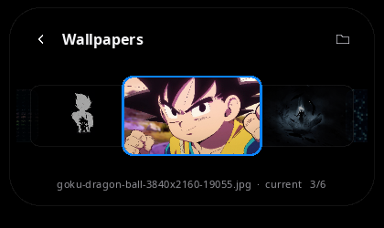
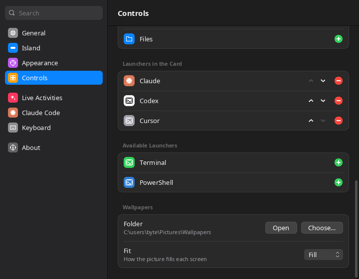

# Loop Island

A Dynamic Island for Windows 10/11 and Linux, written in C++ with Win32, Direct2D, DirectWrite and WinRT. It is one small `.exe` with nothing to install. On Linux it runs through Wine with a launcher script.


Loop Island is a reworked version of [Lost Island for Windows](https://github.com/byte4day/lost-island-windows) by byte4day.

## What's new compared with Lost Island 1.0.2

- **Adaptive island color.** The island samples the screen behind it twice a second. On dark wallpapers it gets a lifted fill, a rim and a soft glow tinted by the colors behind it, so it doesn't vanish. On light backgrounds it stays solid black with a deeper shadow. You can turn this off in Settings › Appearance.

  
- **Lagoon theme.** A cooler palette, a new Lagoon teal accent, and a **Midnight** card with a subtle gradient and a top highlight. Black and Graphite are still there.
- **Smoother motion.** Frames follow the display's refresh through the compositor instead of a 15 ms timer, so motion is no longer uneven. Time is measured with the high-resolution counter, and springs are sub-stepped so they stay stable.
- **Little animations.** Hover, press and on/off states fade instead of snapping. Content settles in from a slightly smaller size after each change, a new live activity cross-fades into the pill, the volume bar glides, and a waiting Claude Code request gently breathes in orange. **Reduce motion** turns the movement off.
- **Faster drawing.** The drawing surface is no longer rebuilt on every frame while the card opens. Text sizes, typography and gradients are cached, and service state is read once per frame instead of dozens of times.
- **Linux.** Icons and the notch shape now draw correctly under Wine, whose Direct2D flattens arcs into straight lines. There's a `loop-island` launcher with install, autostart and uninstall options, and the build works with any distribution's MinGW-w64.
- **Fixes.** On the clock + weather face, playing music no longer disappears. The build no longer fails with GCC's MinGW. Bitmaps are never reused on a recreated render target.

## Install

### Windows

1. Download `LoopIsland.exe` from [Releases](https://github.com/669px/loop-island/releases/latest).
2. Run it from any folder. The island appears at the top of your main display, and Settings opens the first time.
3. Optional: turn on **Start with Windows** in Settings › General.

Windows SmartScreen may warn about an unsigned app the first time. Choose **More info › Run anyway**.

### Linux

You need Wine 8 or newer and an X11 session or XWayland. A compositor (KDE, GNOME, picom…) gives the island its soft edges.

```sh
# Debian/Ubuntu: sudo apt install wine     Fedora: sudo dnf install wine     Arch: sudo pacman -S wine
unzip LoopIsland-win64-linux.zip && cd LoopIsland
./loop-island --install      # copies it to ~/.local and adds "Loop Island" to your app menu
loop-island                  # start it
loop-island --autostart      # optional: start when you log in
loop-island --uninstall
```

The launcher keeps its own Wine prefix in `~/.local/share/loop-island/prefix`. Any `LoopIsland.exe` option works through it, for example `loop-island --toggle`, which you can bind to a key in your desktop's shortcut settings.

On Linux, music, Wi-Fi, Bluetooth, brightness and battery come from Wine's emulation of the Windows services, so some of them may be missing. The clock, weather, timer, clipboard history, Claude Code status, launchers and peeks all work.

## The island

- **Resting pill.** A black capsule, 37 px tall like the iPhone's island, with the Windows mark and the clock, or the clock and the weather. Switch the shape to **Notch** to hang it from the top edge like a MacBook.
- **Live activities.** The most important activity fills the pill, and the next one gets its own round bubble beside it:
  1. **Claude Code needs you.** The Claude spark and, in orange, what it is asking ("Allow Bash?").
  2. **Music.** Album art, title and EQ bars that move with the real output level, in the album's color.
  3. **Claude Code working.** A spinning spark and what it is doing ("Edit app.cpp", "Run tests"). **Done** stays for 8 seconds.
  4. **Downloads** from Chrome, Edge and Firefox in your Downloads folder, with the size received.
  5. **Focus timer.** A progress ring and the time left.
- **Peeks.** Volume, Caps Lock, plugging in the charger, a new track, a picked color and saved screenshots show for a moment and then go away.

| Volume peek | Notch shape |
|---|---|
|  |  |

### Using it

- **Click** the pill to open the card. Click outside it or press <kbd>Esc</kbd> to close it.
- <kbd>Ctrl</kbd>+<kbd>Alt</kbd>+<kbd>I</kbd> opens the card from anywhere. You can change it in Settings › Keyboard.
- **Scroll** over the pill to change the volume, and **middle-click** to play or pause.
- **Right-click** the pill, or the tray icon, for the menu: open card, focus timer, Settings, quit.
- Click the **bubble** to jump to Claude Code's terminal, open the player, or pause the timer.

## The card

- **Music player.** Round cover, title, artist, the app's name, a seek bar you can click, and previous, play and next. The EQ bars take the album's color, or the accent color for dull covers. When a player publishes no track length, the seek bar is hidden.
- **Claude Code sessions.** Each session with its project and what it is doing. Click one to bring its terminal to the front.
- **Controls.** Round buttons, blue when on: Wi-Fi, Bluetooth, Sound, Mic, Focus, Dark mode, Cast, Screen (full screenshot saved to `Pictures\Screenshots` and copied), Area (Windows' snipping overlay), Color picker with a magnifier, Clipboard history, Lock. Night light, Record, Files, Wallpaper, Timer, Power and Settings can be added. Right-click a control to open its page in Windows Settings.
- **Volume and brightness** bars. Brightness shows on laptops (WMI) and on external monitors that support DDC/CI.
- **Launchers** with the Claude, Codex and Cursor logos for their CLIs, opened in Windows Terminal. Terminal and PowerShell can be added.
- **Info line.** Focus timer (click to start or pause, scroll to set 5 to 90 minutes), weather, battery, and the Edit, Power and Settings buttons.
- **Wallpapers** 

  (add the Wallpaper control in edit mode, or run `LoopIsland.exe --wallpapers`): a carousel of `Pictures\Wallpapers`, after Tide Island's switcher. The middle card is full size and its neighbours shrink and fade. Click a side card, scroll or press ←/→ to move; click the middle card or press Enter to set it for every monitor. Type to search by name, Backspace to edit, Esc to clear or close. Pick the folder and the fit (Fill, Fit, Stretch, Center, Tile, Span) in **Settings → Controls → Wallpapers**.

   Thumbnails are made in the background and dropped when the picker closes.
- **Clipboard** lists the last 25 pieces of text you copied. Click one to copy it again. History is kept in memory only, and text that password managers mark as private is skipped.
- **Power** has Lock, Sign out, Sleep, Restart and Shut down. Every action except Lock asks for a second click within 4 seconds.


**Edit the card:** click the pencil, or press and hold any control. Drag a control onto another to move it, click − to remove it, and click + in the tray to add it. Click ✓ when you're done.

## Settings

Settings looks and works like macOS System Settings: a sidebar with search, grouped lists, switches, sliders, pop-up menus and accent colors. Every change applies right away.

| Page | What you can change |
|---|---|
| General | Start with Windows, open the card on hover, hide over fullscreen apps, reduce motion, reset |
| Island | Island or Notch shape (with a live preview), pill face, display (main or the one with the pointer), distance from top, size |
| Appearance | Accent color (Lagoon and the eight macOS colors), Midnight, black or graphite card, adaptive island color, 24-hour clock, seconds, EQ bars |
| Controls | Order, add and remove controls and launchers |
| Live Activities | Each activity and peek, focus timer length and chime, weather city and units |
| Claude Code | Install or remove the status hooks |
| Keyboard | The shortcut that opens the card |

 

Settings are saved in `%APPDATA%\LoopIsland\config.json`.

## Claude Code status

Open Settings › Claude Code and click **Install**, or run:

```powershell
LoopIsland.exe --setup-claude-status
```

It copies a small hook to `%LOCALAPPDATA%\LoopIsland\LoopIslandHook.exe`, backs up `~/.claude/settings.json`, and adds the hook to Claude Code's session events next to any hooks you already have. New sessions then report what they are doing. `--remove-claude-status` takes the hooks out again.

The hook writes one small file per session to `%LOCALAPPDATA%\LoopIsland\claude-status\`, prints nothing, and always exits 0, so it never slows Claude Code down or adds text to the conversation.

## Command line

```text
LoopIsland.exe                     start (or open Settings when already running)
LoopIsland.exe --toggle            open or close the card
LoopIsland.exe --wallpapers        open the wallpaper picker
LoopIsland.exe --timer             start or pause the focus timer
LoopIsland.exe --settings [page]   open Settings (general, island, appearance, controls, activities, claude, keyboard, about)
LoopIsland.exe --quit              quit
```

On Linux, use `loop-island` in place of `LoopIsland.exe`.

## How it works

- **One layered window.** The island is a top-most `WS_EX_LAYERED` window. Each frame is drawn with Direct2D into a 32-bit surface and handed to `UpdateLayeredWindow`, so transparent pixels click through to whatever is underneath. The window is only as tall as what it shows.
- **Springs.** Width, height, corner radius, content fade and the bubble are separate damped springs, stepped at about 60 fps only while something moves. At rest the island redraws once a second for the clock.
- **Services.** Each system service has a small module in `src/services/`:
  - Core Audio for volume, mute, mic and the output level.
  - Global System Media Transport Controls (WinRT) for now playing.
  - `Windows.Devices.Radios` for Wi-Fi and Bluetooth.
  - The WLAN API for the network name.
  - WMI or DDC/CI for brightness.
  - WinHTTP and wttr.in for weather.
  - A clipboard format listener for clipboard history.
  - Folder change notifications for downloads and Claude Code.

  Slow calls run on worker threads and post a message when something changes.
- **No WinRT projection.** The WinRT interfaces it needs are declared by hand in `src/services/winrt_abi.h`. Their IIDs and method order were taken from the Windows SDK metadata, and the generic IIDs were computed with the WinRT algorithm.
- **Icons are vectors** drawn in code in the style of SF Symbols, so they look the same on every Windows version and need no icon font.

- **Adaptive color.** Twice a second the island copies a small strip of the screen behind it, scaled down to 24×6 pixels. On Windows, a screen copy without `CAPTUREBLT` leaves out layered windows, so the island never samples itself; under Wine it reads the strip just below its window instead. Brightness and hue ease to their new values over about half a second.
- **Frame pacing.** While something moves, a small thread waits on `DwmFlush` and posts one frame message per composition pass, never queuing more than one. Where `DwmFlush` doesn't block (Wine, composition off), a 60 Hz high-resolution timer stands in.

## Build

On Linux (any distribution with MinGW-w64, or with [llvm-mingw](https://github.com/mstorsjo/llvm-mingw)):

```sh
sudo apt install g++-mingw-w64-x86-64-posix cmake    # Debian/Ubuntu
./scripts/build.sh                                    # writes build/LoopIsland.exe
```

`scripts/build.sh` uses llvm-mingw when `LLVM_MINGW` is set or one is found in `~/.local/opt`, and the system MinGW-w64 otherwise. GitHub Actions builds every push the same way and attaches the `.exe` and the Linux zip to tagged releases.

On Windows with Visual Studio 2022 (Desktop C++ workload):

```powershell
cmake -B build -G "Visual Studio 17 2022" -A x64
cmake --build build --config Release
```

## Limits

- Windows has no public way to switch Focus (Do Not Disturb) or Night light, so those buttons open their Settings pages.
- **Record** sends Snipping Tool's recording shortcut, which needs a current Windows 11.
- **Wi-Fi** and **Bluetooth** need a radio that Windows exposes as switchable. Otherwise the buttons open Settings.
- Notification banners are not shown. Reading other apps' notifications requires a packaged app with the notification listener capability.
- The screenshots in this README were rendered with the release build running under Wine on Linux, so fonts differ from Windows (Noto Sans instead of Segoe UI).
- The sample song and Claude request in the screenshots come from `LOOPISLAND_DEMO=1`, an environment variable that exists only for screenshots.

- On Linux the island is an X11 window through Wine, so on a Wayland session it needs XWayland. It can't sit above fullscreen Wayland-native apps.

## Credits

Loop Island is based on [Lost Island for Windows](https://github.com/byte4day/lost-island-windows) by [byte4day](https://github.com/byte4day), a port of [Lost Island for Sway](https://github.com/byte4day/lost-island-archcraft-sway), which grew out of [Marco Zorn's Lost Island](https://github.com/MarcoZorn/lost-island) (MIT). The island's proportions follow Apple's Live Activity guidelines for the Dynamic Island.

MIT License. See [LICENSE](LICENSE).
