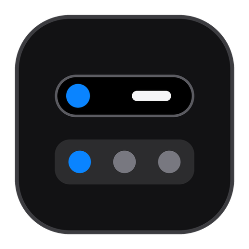
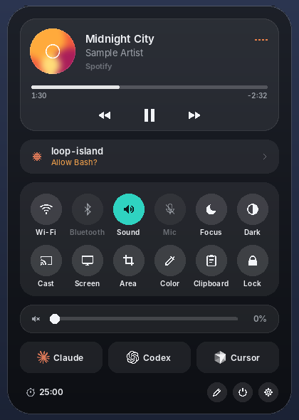
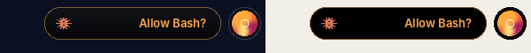
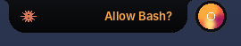
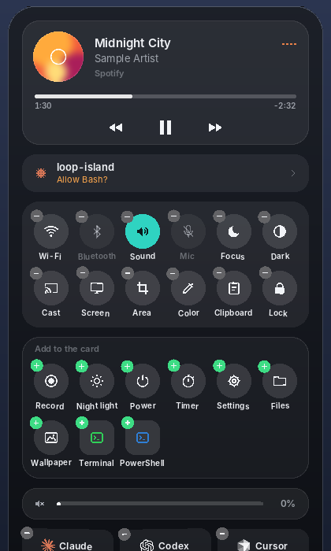
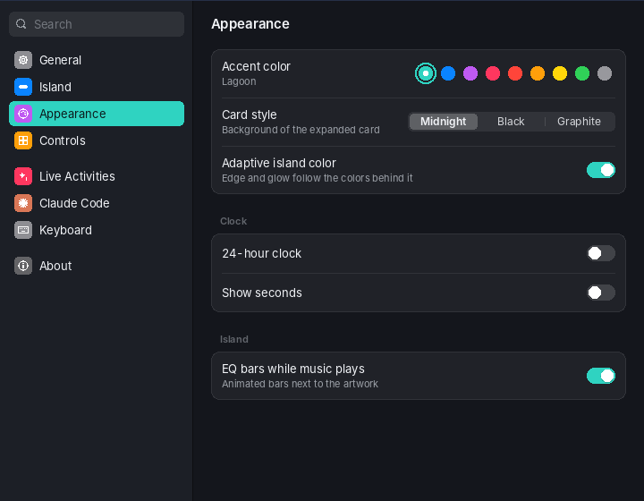
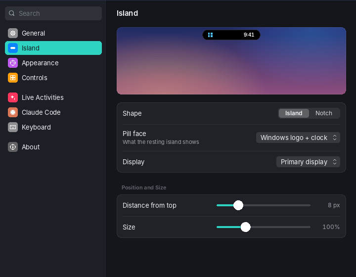
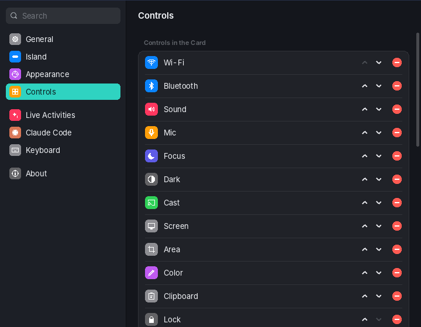

<p align="center"></p>

<h1 align="center">loop-island</h1>

<p align="center">A Dynamic Island for your Windows and Linux desktop.<br>
One small <code>.exe</code>, nothing to install, and it takes on the colors of whatever is behind it.</p>

<p align="center">
  <a href="https://github.com/669px/loop-island/releases/latest"><b>Download</b></a> ·
  <a href="#install">Install</a> ·
  <a href="#features">Features</a> ·
  <a href="#build-from-source">Build</a>
</p>

<p align="center"></p>

<p align="center"></p>

## Download

Every release on the [Releases page](https://github.com/669px/loop-island/releases/latest) has three files:

| File | What it is |
|---|---|
| `loop-island.exe` | The app for Windows 10 and 11. Download it and run it. |
| `loop-island-win64-linux.zip` | The same exe plus the Linux launcher, README and license. |
| Source code (zip / tar.gz) | The full source at that version. GitHub adds this automatically. |

## Install

### Windows

1. Download `loop-island.exe` from [Releases](https://github.com/669px/loop-island/releases/latest).
2. Run it from any folder. The island appears at the top of your screen, and Settings opens the first time.
3. To start it with Windows, turn on **Start with Windows** in Settings › General.

The exe isn't signed, so the first time Windows SmartScreen may show a warning. Click **More info › Run anyway**.

### Linux

loop-island runs through Wine. You need Wine 8 or newer and an X11 session or XWayland. With a compositor (KDE, GNOME, picom…) the island gets its soft edges.

```sh
# Debian/Ubuntu: sudo apt install wine
# Fedora:        sudo dnf install wine
# Arch:          sudo pacman -S wine
unzip loop-island-win64-linux.zip && cd loop-island
./loop-island --install      # copies it to ~/.local and adds loop-island to your app menu
loop-island                  # start it
loop-island --autostart      # optional: start it when you log in
loop-island --uninstall      # remove it and its Wine prefix
```

Any option of `loop-island.exe` also works through the launcher. For example, bind `loop-island --toggle` to a key in your desktop's shortcut settings.

## Features

### Adaptive color

Twice a second, loop-island reads the screen just behind the island. On a dark wallpaper the island lifts slightly and gets a thin edge and a soft glow tinted with the colors behind it, so it never disappears. On a light background it stays deep black with a soft shadow. The change fades in smoothly.

<p align="center"></p>

You can turn it off in Settings › Appearance.

### Live activities

The most important activity fills the island, and the next one gets its own round bubble beside it.

- **Claude Code needs you.** Shows the Claude spark and the question it's asking, such as "Allow Bash?", with a gentle orange pulse.
- **Music.** Shows album art, the title, and EQ bars that move with the real sound, in the album's color. Spotify, browsers, Media Player and VLC all work.
- **Claude Code working.** A spinning spark and what it's doing ("Edit app.cpp", "Run tests").
- **Downloads** from Chrome, Edge and Firefox, with the size so far.
- **Focus timer** with a progress ring.

### Peeks

Volume, Caps Lock, the charger, a new song, a picked color and screenshots show up briefly and then go away.

| Volume | Notch shape |
|---|---|
|  |  |

### The card

Click the island to open the card:

- **Music player** with seek bar and controls.
- **Claude Code sessions.** Click one to jump to its terminal.
- **Quick controls:** Wi-Fi, Bluetooth, Sound, Mic, Focus, Dark mode, Cast, Screenshot, Area snip, Color picker, Clipboard history and Lock. You can also add Record, Night light, Files, Wallpaper, Timer, Power and Settings.
- **Volume and brightness** sliders.
- **Launchers** for Claude, Codex and Cursor, plus Terminal and PowerShell.
- **Focus timer, weather and battery.**

To rearrange the card, click the pencil or press and hold any control. Drag controls to move them, tap − to remove one and + to add one.

<p align="center"></p>

### Smooth motion

Every change of shape runs on a spring, synced to your display's refresh rate. Buttons ease when you hover over or press them, toggles fade between on and off, and new content settles in gently. **Reduce motion** in Settings tones all of this down.

### Lagoon theme

The new default theme is a cool, deep palette with a teal **Lagoon** accent and a **Midnight** card. Eight other accent colors and the Black and Graphite card styles are also available.

## Using it

| Do this | To |
|---|---|
| Click the island | Open or close the card |
| <kbd>Ctrl</kbd>+<kbd>Alt</kbd>+<kbd>I</kbd> | Open the card from anywhere (change it in Settings › Keyboard) |
| Scroll over the island | Change the volume |
| Middle-click | Play or pause music |
| Right-click | Menu: card, focus timer, Settings, quit |
| <kbd>Esc</kbd> or click outside | Close the card |

## Settings

<p align="center"></p>

| Page | What you can change |
|---|---|
| General | Start with Windows, open on hover, hide over fullscreen apps, reduce motion |
| Island | Island or notch shape, what the island shows, which display, position and size |
| Appearance | Accent color, card style, adaptive color, clock format, EQ bars |
| Controls | Which controls and launchers are on the card, and their order |
| Live Activities | Which activities and peeks to show, timer length, weather city |
| Claude Code | Install or remove the Claude Code status hook |
| Keyboard | The shortcut that opens the card |

<p align="center">
  
  
</p>

Settings are saved in `%APPDATA%\LoopIsland\config.json`.

## Claude Code status

Open Settings › Claude Code and click **Install**, or run:

```powershell
loop-island.exe --setup-claude-status
```

This adds a small hook to Claude Code, and your sessions then show up in the island. The hook stays silent and never slows Claude Code down. To remove it, run `loop-island.exe --remove-claude-status`.

<p align="center"></p>

## Command line

```text
loop-island.exe                     start (or open Settings if it's already running)
loop-island.exe --toggle            open or close the card
loop-island.exe --wallpapers        open the wallpaper picker
loop-island.exe --timer             start or pause the focus timer
loop-island.exe --settings [page]   open Settings at a page
loop-island.exe --quit              quit
```

On Linux, use `loop-island` in place of `loop-island.exe`.

## Build from source

On Linux:

```sh
sudo apt install g++-mingw-w64-x86-64-posix cmake   # Debian/Ubuntu
./scripts/build.sh                                   # writes build/loop-island.exe
```

On Windows, with Visual Studio 2022:

```powershell
cmake -B build -G "Visual Studio 17 2022" -A x64
cmake --build build --config Release
```

GitHub Actions builds every push. Each push to `main` publishes the release for the version in `CMakeLists.txt`, with `loop-island.exe` and `loop-island-win64-linux.zip` attached. To start a new release, bump the version and update `.github/release-notes.md`.

## Good to know

- Windows has no public API for Focus (Do Not Disturb) or Night light, so those buttons open their Settings pages.
- Wi-Fi and Bluetooth need a radio that Windows can switch. Otherwise the buttons open Settings.
- On Linux, music, Wi-Fi, Bluetooth, brightness and battery depend on Wine's support and may be missing. The clock, weather, timer, clipboard, Claude Code status, launchers and peeks all work.
- The screenshots were taken on Linux, so the font is Noto Sans instead of Segoe UI.

## License

loop-island is made by [669px](https://github.com/669px) and released under the MIT License. See [LICENSE](LICENSE).
